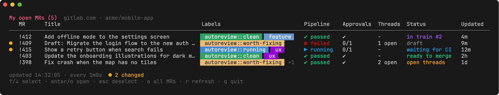
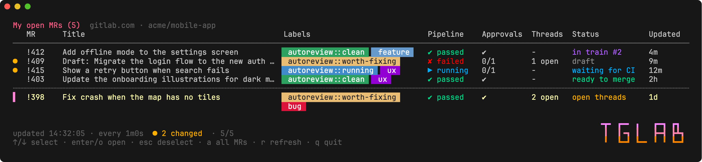
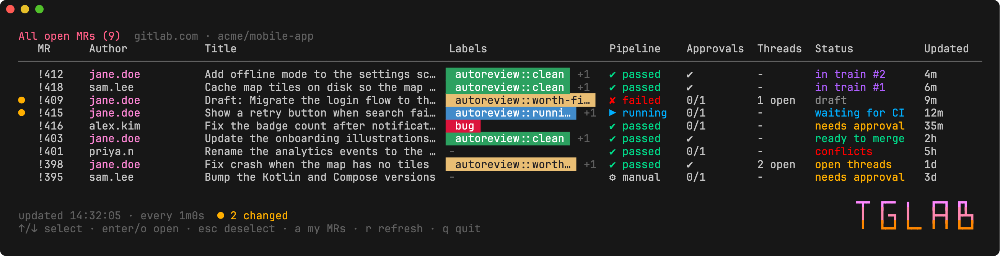

# tglab

A terminal dashboard for GitLab merge requests. It keeps showing the open MRs you opened, or every
open MR in your projects, with pipeline, approvals, open threads, merge status, merge train position
and labels, and refreshes on a timer.



The selected row expands to show the full title and every label:



`a` switches to every open MR in the project, with an Author column:



The screenshots use made-up data.

## Requirements

- Go 1.24.2 or newer, to build it (`brew install go`)
- A GitLab token with the `read_api` scope. If you're logged in with
  [`glab`](https://gitlab.com/gitlab-org/cli), nothing else is needed.

## Build and run

```sh
scripts/build.sh                 # ./tglab, with `git describe` as its --version
scripts/install.sh               # or build it into ~/bin (or $INSTALL_DIR)
./tglab                          # uses the settings file described below
./tglab --config path/to/config.yaml
./tglab --help                   # also --usage and -h
./tglab --version
```

Prebuilt binaries for macOS, Linux and Windows are attached to each
[release](https://github.com/allco/tglab/releases).

`--help` prints where the settings file is looked for, which file is in use right now, the full
default settings, where the token comes from, and the keys.

## Settings

The full reference, with examples for common setups and a troubleshooting table, is in
[docs/configuration.md](docs/configuration.md).

The settings file is YAML. The first of these that exists is used:

1. the path given with `--config <path>`
2. `./tglab.yaml` in the current directory
3. `~/.config/tglab/config.yaml`, or `$XDG_CONFIG_HOME/tglab/config.yaml` if that's set

If none exists, `~/.config/tglab/config.yaml` is created with the defaults on first run. The
defaults are the same as [`config.example.yaml`](config.example.yaml):

```yaml
# GitLab host (without scheme).
host: gitlab.com

# Projects to watch (full paths). Leave empty to show your open MRs across all projects.
projects: []
#  - my-group/my-project

# How often to refresh, e.g. 30s, 1m, 5m.
refresh_interval: 60s

# Labels to show: regular expressions matched against the label name. When set, only
# matching labels are shown; when empty, all are. Quote them, since a trailing ":" is
# YAML syntax.
show_labels: []
#  - "^autoreview::"

# Labels to hide, applied after show_labels.
hide_labels: []
#  - "^platform::"

# Personal access token (read_api scope). Optional.
# token: glpat-...
```

| Setting | Default | Notes |
|---|---|---|
| `host` | `gitlab.com` | A leading `https://` and a trailing `/` are stripped. |
| `projects` | `[]` | Full project paths. Empty means your MRs in every project, and no "all" view. |
| `refresh_interval` | `60s` | Any Go duration. Values under `10s` are raised to `10s`. |
| `show_labels` | `[]` | Go regular expressions. When set, only matching labels are shown. An invalid one stops the app at startup with an error. |
| `hide_labels` | `[]` | Go regular expressions, applied after `show_labels`. An invalid one stops the app at startup. |
| `token` | none | See [Token](#token). |

`./tglab.yaml` is listed in `.gitignore`, since it may hold a token.

## Token

The first of these that is set is used:

1. `token` in the settings file
2. the `GITLAB_TOKEN` environment variable
3. the token stored by `glab` (`glab auth login --hostname <host>`)

## Keys

| Key | Action |
|---|---|
| `↓` / `j` | select the top row on screen, then move down |
| `↑` / `k` | select the last MR, then move up |
| `pgdn` / `pgup` | move 5 rows |
| `G` / `end`, `g` / `home` | jump to the last or first MR |
| `enter` / `o` | open the selected MR in the browser |
| `esc` | clear the selection |
| `a` | switch between my MRs (the default) and all MRs in the projects |
| `r` | refresh now |
| `q` / `ctrl+c` | quit |

## Views and refreshing

On start, a `tglab` splash shows while the first load runs (at least 1.2 seconds); any key skips
it. After that, a small logo sits in the bottom-right corner, beside the status and help lines, whenever
the rows and the window leave room for it.

Each refresh fetches every open MR in the configured `projects` in one request per project. "My
MRs" is that list filtered to MRs you authored, so `a` switches views instantly without a new
request. In the all view an **Author** column appears, with your own username highlighted.

The selection stays on the same MR across refreshes and view switches, and clears if that MR is no
longer shown.

## Columns

| Column | Shows |
|---|---|
| (marker) | `▌` on the selected row; `●` if the MR changed on the last refresh |
| MR | `!iid` |
| Project | only when more or fewer than one project is configured |
| Author | only in the all view |
| Title | truncated to one line; the selected row shows it in full |
| Labels | coloured pills, see [Labels](#labels) |
| Pipeline | head pipeline: `✔ passed`, `✘ failed`, `▶ running`, `… pending`, `⊘ canceled`, `» skipped`, `⚙ manual` |
| Approvals | `given/required`, or `✔` when approved |
| Threads | unresolved threads, e.g. `1 open` |
| Status | see below |
| Updated | time since the MR was last updated |

**Status**, the first that applies. It's coloured by what it asks of you: green ready, red
broken, amber needs action, blue waiting on CI, purple merging on its own, grey not ready yet.

| Shows | Means |
|---|---|
| `in train #N` | on the merge train at position N |
| `conflicts` | has merge conflicts |
| `train after CI` | set to join the merge train once checks pass |
| `in train` | merge train strategy set, no position yet |
| `auto-merge` | set to merge when the pipeline succeeds |
| `ready to merge`, `draft`, `checking`, `waiting for CI`, `needs approval`, `open threads`, `needs rebase`, `blocked` | GitLab's merge status |

**The `●` marker** means something about the MR changed since the previous refresh: pipeline,
approvals, open threads, labels (hidden ones don't count), merge status, train position or title.
It lasts until the next refresh, and nothing is marked on the first load. The status line counts
the marked MRs in the current view, e.g. `● 2 changed`.

## Labels

Each label is a pill in its GitLab background and text colours, sorted alphabetically ignoring
case. If `show_labels` is set, only labels matching one of its patterns are shown; then labels
matching any `hide_labels` pattern are left out. On a normal row the labels stay on
one line and any that don't fit are counted as `+N`; the selected row expands to show them all.

## Development

```sh
go test ./...
go vet ./...
```

To regenerate the screenshots after a UI change, install
[freeze](https://github.com/charmbracelet/freeze) and Google Chrome, then run
`./scripts/screenshots.sh`.

| File | Contains |
|---|---|
| `docs/configuration.md` | settings reference and examples |
| `scripts/build.sh`, `scripts/install.sh` | build with the version from `git describe`; install into `~/bin` |
| `screenshot_test.go`, `scripts/screenshots.sh` | renders the README screenshots from made-up MRs |
| `main.go` | flags, `--help` text, startup |
| `config.go` | settings file lookup, defaults, label patterns, token lookup |
| `gitlab.go` | GraphQL queries and client |
| `ui.go` | the Bubble Tea app: table rendering, keys, refresh loop |
| `splash.go` | the start-up splash and the corner logo |

### CI and releases

- `.github/workflows/post-merge.yml` ("Post merge") checks formatting, vets, tests and builds on every push to `main`.
- `.github/workflows/release.yml` runs when a semver tag is pushed. It tests, builds for macOS,
  Linux and Windows (amd64 and arm64) with the tag as the version, and creates a GitHub release
  with each binary, an archive per platform and a `checksums.txt`. A tag with a suffix, like `v1.1.0-rc.1`, becomes a
  pre-release.

To release:

```sh
git tag v1.0.0
git push origin v1.0.0
```

It uses the GitLab GraphQL API (`/api/graphql`) and the
[Bubble Tea](https://github.com/charmbracelet/bubbletea) and
[Lip Gloss](https://github.com/charmbracelet/lipgloss) libraries.
